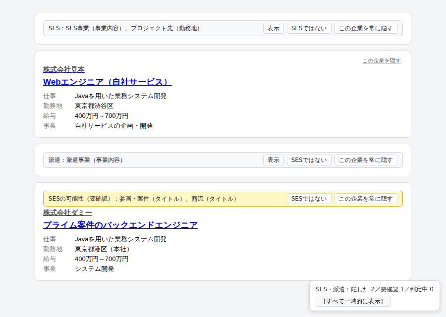

# SES フィルター（ses-filter）

エンジニア求人サイトの検索結果で、SES・派遣の求人を理由つきで畳む Chrome 拡張機能です。対応サイトは paiza転職、Green、doda、マイナビ転職（IT エンジニア職の検索結果）、リクナビNEXT（検索結果）です。今後、対応サイトを増やしていく予定です。



（画面は、テスト用に作った合成のページで撮ったものです。企業名は架空です）

作ったものを見せるために公開しています。Chrome Web Store には出していないので、使うときは下の手順でビルドして読み込んでください。

## 何をするか

- 検索結果のカードを読み、SES（客先常駐）や派遣の求人だと判断したら、1行のバーに畳みます。バーには理由（どの欄のどの言葉に当たったか）を出します。
- バーの「表示」でその場だけ開き、「SESではない」で隠さないようにし、「この企業を常に隠す」で企業ごと隠せます。
- 決めきれない求人は畳まずに「要確認」の印を付けます。
- ポップアップで、表示の仕方（畳む・消す・薄く）とサイトごとのオン・オフを切り替えられます。

## 判定の仕組み

- カードの文字（タイトル、勤務地、事業内容、本文）に言い回しのルールを当てます。「客先常駐」「プロジェクト先」「SES事業」「労働者派遣事業」のような強い言い回しなら畳み、「参画」「商流」のような弱い言い回しだけなら要確認にします。「客先常駐なし」「脱SES」「SES経験者歓迎」「Amazon SES」のような否定や別の意味は数えません。
- paiza では、求人の詳細ページにあるサイト自身の分類（開発内容タイプの「受託開発（社外常駐）」など）でも判断します。マイナビ転職にはサイト自身の分類がないので、詳細ページの事業内容・勤務地・本文に同じルールを当て、雇用形態の「派遣」も見ます。いまの版では、自分で開いた詳細ページの結果を記録し、次に一覧を開いたときの判定に使います。一覧に出た求人の詳細ページを拡張機能が1秒に1件ずつ読みに行く「先読み」は、1.0.0 で入れる予定です（仕組みはできていて、それまでは止めています）。
- リクナビNEXTでは、カードの雇用形態のタグ（「派遣社員」）と、フリーランスエージェントの案件募集の言い回し（「稼働時期応相談」「高単価案件」「待機基本0」）も見ます。詳細ページは読みません。
- 企業単位でも判断します。事業内容に SES や派遣と書いてある企業や、ほかの求人が対象になった企業は、その企業のどの求人も畳みます。自社内の開発と社外常駐の両方がある企業は、エンジニアから見ると SES になる可能性があるためです。

詳しくは [docs/design.md](docs/design.md) にあります。

## 精度

保存した検索結果のページと、正解ラベルで測りました。対象は SES と派遣の求人です。

paiza転職・Green・doda（2026-10-17）:

| データ | 求人 | 対象 | 隠した | 適合率 | 再現率 |
|---|---|---|---|---|---|
| 調整用（ルールを直すのに使ったページ） | 287 | 163 | 141 | 100.0% | 86.5% |
| 確かめ用（ルールを直し終えてから集め、1回だけ測ったページ） | 89 | 34 | 33 | 90.9% | 88.2% |

マイナビ転職（IT エンジニア職の検索結果。2026-10-18〜19 に追加）:

| データ | 求人 | 対象 | 隠した | 適合率 | 再現率 |
|---|---|---|---|---|---|
| 調整用（最初の測定） | 100 | 88 | 90 | 96.7% | 98.9% |
| 確かめ用（1回目） | 61 | 53 | 57 | 91.2% | 98.1% |

リクナビNEXT（検索結果。2026-10-20 に追加。詳細ページは読まない）:

| データ | 求人 | 対象 | 隠した | 適合率 | 再現率 |
|---|---|---|---|---|---|
| 調整用（最初の測定） | 202 | 96 | 37 | 100.0% | 38.5% |
| 調整用（エージェントのルールを足した後） | 202 | 96 | 90 | 100.0% | 93.8% |
| 確かめ用（1回目） | 200 | 39 | 33 | 97.0% | 82.1% |

- 適合率は、隠した求人のうち本当に対象だった割合です。再現率は、対象の求人のうち隠せた割合です。ラベルが「不明」の求人（3サイトの調整用8件、確かめ用3件）は数えていません。
- マイナビ転職の誤り（調整用3件、確かめ用5件。「客先常駐原則なし」「SES企業での開発経験」のような否定や経歴の書き方）は、測ったあとでルールを直し、直したあとは調整用・確かめ用とも誤って隠したものが0件です。既存3サイトの数字は変わっていません。
- 先読みをオンにした状態で測った数字です。先読みを止めているいまの版では、paiza とマイナビ転職の再現率はこれより下がります。
- リクナビNEXTはフリーランスエージェントの案件募集が多く、その言い回しのルールを調整用で足しました。確かめ用で誤って隠した1件（「客先常駐ナシ」のカタカナの否定）は、測ったあとで直しました。
- 確かめ用で誤って隠したもの（3サイトで3件、マイナビ転職で5件、リクナビNEXTで1件）は、測ったあとでルールを直しました。直したあとの確かめ用の数字は、調整に使っていないデータでの精度を表さないので、ここには1回目の数字を載せています。
- 保存したページとラベルは、サイトの内容と企業ごとの判断を含むので公開していません。

## 限界と注意

- 誤って畳むことも、見逃すこともあります。気になる求人は、畳まれていても開いて確かめてください。
- サイトの作りが変わると、カードを読めなくなります。そのときは画面右下に ⚠ の警告が出ます。
- 判定はすべてブラウザの中で行い、判定の結果や閲覧した内容を外部に送りません。保存するデータと残る期間は [PRIVACY.md](PRIVACY.md) にあります。
- 企業名の一覧は持っておらず、配ってもいません。対象かどうかは求人に書かれた言葉から機械的に判断したもので、企業についての評価ではありません。
- 各サイトの利用規約は、使う人が自分で確かめてください。この README は法的な助言ではありません。

## ビルドと読み込み

Node.js 24 以上と pnpm が要ります。

```bash
pnpm install
pnpm exec wxt prepare   # pnpm 12 では postinstall が走らないことがあるため
pnpm build
```

1. Chrome で `chrome://extensions` を開き、右上の「デベロッパー モード」をオンにします。
2. 「パッケージ化されていない拡張機能を読み込む」で `.output/chrome-mv3` フォルダを選びます。

## 開発

```bash
pnpm dev                                # 開発用のビルド（.output/chrome-mv3-dev を読み込む）
pnpm test                               # 単体テスト
pnpm typecheck                          # 型チェック
pnpm exec playwright install chromium   # E2E テストの準備（初回だけ）
pnpm test:e2e                           # 拡張機能を読み込んだ E2E テスト（本物のサイトには接続しない）
```

保存したページ（`tests/fixtures/`）を使うテストは、ページがないと飛ばされます。

### 自分で保存したページで精度を測る

`eval/` に精度を測る仕組みがあります。測り方は [docs/design.md](docs/design.md) の「精度の測り方」にあります。

1. ログインせず、拡張機能を切った状態（Chrome のシークレットウィンドウなど）で検索結果を開きます。DevTools の Elements で `<html>` を右クリックし、Copy → Copy outerHTML でコピーして、`eval/pages/<サイト>/<日付>-<名前>.html` に保存します（サイトは `paiza`・`green`・`doda`・`mynavi`）。paiza とマイナビ転職の詳細ページは `<日付>-detail-<求人ID>.html` の名前で保存すると、先読みをオンにした状態の判定に使います（マイナビ転職の求人IDは `<企業ID>-<n>-<m>-<k>` の形で、URL 末尾に `adv1/` の付かないページを使います。`pnpm eval:pick-mynavi` が、先読みが読む求人のうち保存していないものの URL を出します）。
2. `node scripts/strip-scripts.ts <ファイル>` でスクリプトを取り除き、`node scripts/check-pages.ts <ファイル>` で、拡張機能の印やログイン中の表示が残っていないことを確かめます。
3. `pnpm eval:cards` で、ラベル付け用の一覧（`eval/.work/<サイト>-cards.md`。判定の結果は載せない）と、ラベルのひな形（`eval/labels/<サイト>.json`。すべて `unknown`）を作ります。
4. 一覧を見て、[docs/design.md](docs/design.md) の「ラベルの定義」に沿って `label` と `evidence` を書きます。
5. `pnpm eval` で測り、`eval/report.md` に書き出します。`pnpm eval:review` は、ラベルと判定が食い違うものなどを `eval/review.md` にまとめます。

保存したページ、ラベル、報告にはサイトの内容と企業ごとの判断が入るので、`.gitignore` で git の管理から外しています。公開しないでください。サイトのページを自動で取りに行く道具は、このリポジトリに入れていません。

## ライセンス

SES フィルターは [MIT license](LICENSE) の元で公開されています。
